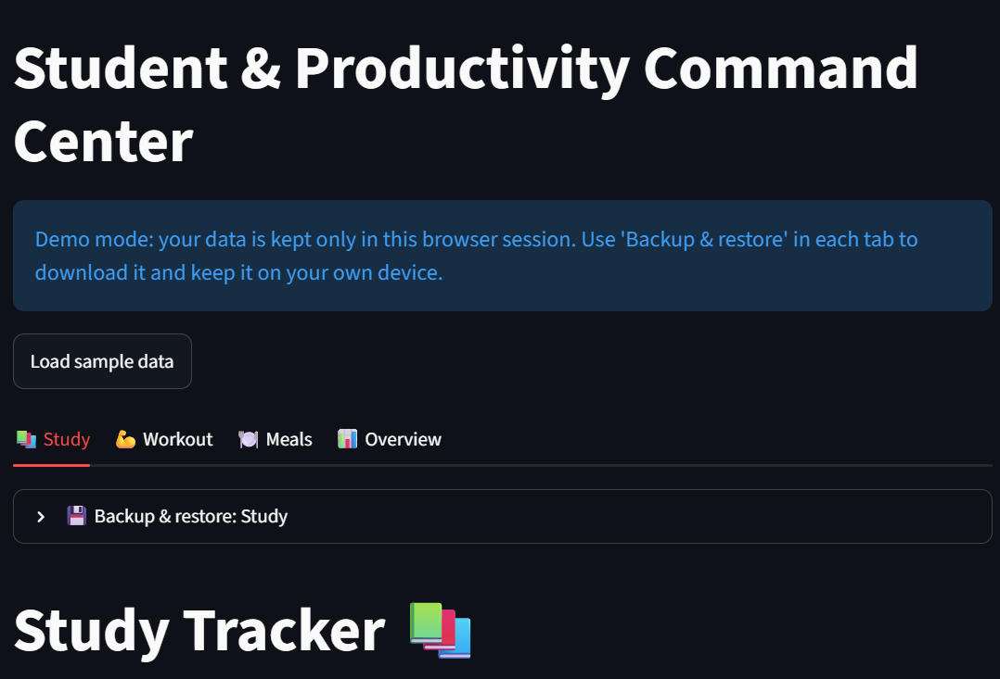
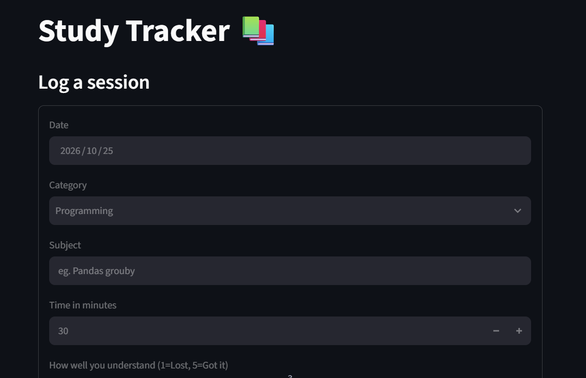

# Student & Productivity Command Center

A mobile-friendly web app for tracking study sessions, workouts and meals, with weekly and monthly analytics. Built with Python, Streamlit and Pandas.

**Live demo:** student-appuctivity-command-center-5byq8syhwsc6sk68dfj8bt.streamlit.app

Open it and press **Load sample data** to see the analytics with three weeks of example entries.



## Features

- **Study tracker:** log sessions by category with time and a 1–5 understanding rating; weekly totals and summaries per category.
- **Workout log:** log activities with duration, intensity and estimated calories burned; per-activity summaries over 7 days, 30 days or all time.
- **Meal log:** log meals with calories; daily totals and a daily chart.
- **Overview:** weekly and monthly comparison of calories eaten and calories burned in workouts.
- **Backup and restore:** download any log as a CSV file and restore it later. Every restored row goes through the same validation as manual entries, and a file with any invalid row is rejected as a whole.
- **Demo mode:** the public demo keeps each visitor's data in their own session, so visitors never see each other's data.

| Study | Workout |
|---|---|
|  |  |

## Architecture

- storage.py: the storage layer. An abstract Storage class with CSVStorage (local files) and SessionStorage (per-visitor session data).
- base_tracker.py: BaseTracker, the shared parent class. It handles loading, structure checks, date handling, appending rows, and CSV export and import. It also holds the shared validation helpers and error types.
- study_tracker.py, workout_tracker.py, meal_tracker.py: child classes that define only their own columns and validation rules.
- analytics.py: Pandas aggregations (groupby, period totals, summaries), kept separate from data management.
- sample_data.py: example data for the public demo.
- app.py: the Streamlit interface.

## Design decisions

- **Validation before storage:** every input is validated before anything is written, so invalid data never reaches the log.
- **Custom errors:** ValidationError (fix your input) and StorageError (a problem with the stored data) are handled differently in the interface.
- **Pluggable storage:** trackers receive a storage object instead of a file path. Running locally uses CSV files; the public demo uses session storage, because the hosting platform's filesystem is not persistent and is shared between visitors.
- **All-or-nothing import:** uploaded files are checked row by row in a temporary in-memory tracker, and the real data is replaced only if every row is valid.

## Your data

- **Local use:** your data is saved as CSV files in the data/ folder, which is not tracked by Git.
- **Public demo:** data lives only in your browser session and disappears when you refresh or close the page. Use *Backup & restore* in each tab to download it and keep it on your own device.

## Run locally

```
python -m venv .venv
.venv\Scripts\activate
pip install -r requirements.txt
streamlit run app.py
```

To try the demo mode locally, set the environment variable STORAGE_MODE=session before running.

## Tech stack

Python, Streamlit, Pandas.